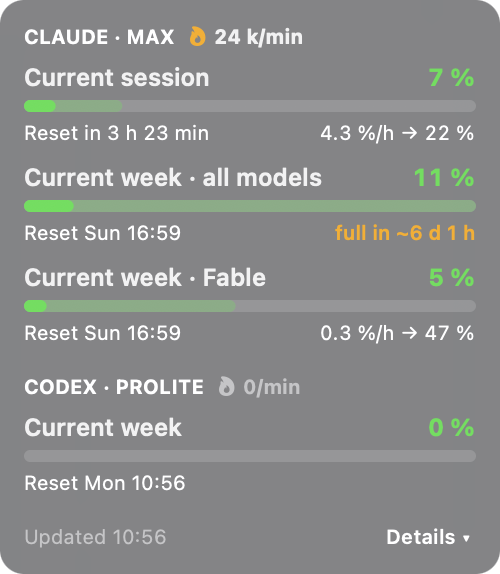
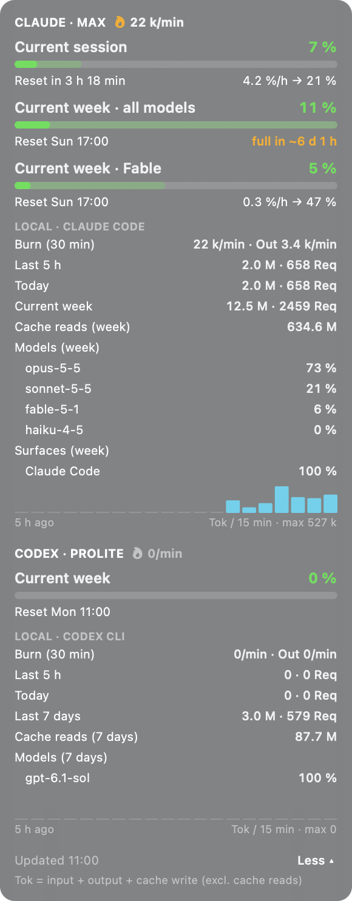

# burnrate

A tiny always-on-top widget that shows how fast you're burning through your **Claude Code** and **Codex** limits – right on your desktop, refreshed every two minutes.

  
  &nbsp;
  

## What it shows

- **Limits in %**: current session and week, the same numbers `/usage` (Claude Code) and `/status` (Codex) show, plus time until reset.
- **Pace & projection**: average %/h since the window started and where you'll land at reset (the lighter part of the bar). If you'd hit the limit before the reset, it tells you when.
- **Burn rate** 🔥: tokens per minute over the last 30 minutes, read from the local session logs.
- **Details** (macOS, click *Details ▾*): tokens for the last 5 h / today / this week, split by model, and a 5-hour activity chart.
- Only the tools you actually have set up are shown. German UI on German systems, English everywhere else.

## Requirements

- You're logged in to **Claude Code** with a subscription and/or the **Codex CLI** with a ChatGPT account.
- **macOS**: Swift compiler from the Xcode Command Line Tools (`xcode-select --install`). The widget is compiled on first start (takes a few seconds).
- **Windows 10/11**: nothing – Windows PowerShell 5.1 is preinstalled.

## Start

Download or clone the repo, then:

| | Start | Autostart at login |
|---|---|---|
| **macOS** | Double-click `start.command` | `macos/install-autostart.sh` |
| **Windows** | Double-click `start.cmd` | `powershell -ExecutionPolicy Bypass -File windows\install-autostart.ps1` |

To remove the autostart again: `macos/uninstall-autostart.sh` or `windows\uninstall-autostart.ps1`.

If macOS refuses to open `start.command` (downloaded ZIP), right-click it → *Open* once, or run `./start.command` in Terminal.

**Using it:** drag the widget wherever you like (the position is remembered), right-click for *Refresh now*, *Move to top left* and *Quit*.

## Configuration

Everything lives in [`config.env`](config.env): refresh interval, burn-rate window, endpoints and file locations. Run the start script again after changing it.

## How it works

- It reuses the login token Claude Code and Codex already store on your machine (macOS Keychain or `~/.claude/.credentials.json`, and `~/.codex/auth.json`) and calls the same usage endpoints the CLIs call. The token is only ever sent to those endpoints. burnrate never refreshes tokens – if one has expired, just open Claude Code or Codex once.
- Token counts come from the local session logs (`~/.claude/projects`, `~/.codex/sessions`). They're read, never sent anywhere. That's also why they only cover Claude Code and the Codex CLI, not claude.ai or ChatGPT in the browser.
- "Tok" = input + output + cache-write tokens. Cache reads are shown separately; they're cheap and would drown out everything else.

## Good to know

- **Unofficial.** Not affiliated with Anthropic or OpenAI. The usage endpoints are undocumented and may change at any time – if they do, the widget shows a warning instead of numbers.
- Don't set the refresh interval too low: the endpoints rate-limit (HTTP 429).
- The weekly projection is a straight-line extrapolation, so it overshoots early in the week.
- The Windows version is newer and has seen less testing than the macOS one. Issues and PRs welcome.

## Make it yours

It's deliberately small: one Swift file for macOS (`macos/Burnrate.swift`), one PowerShell file for Windows (`windows/Burnrate.ps1`). Fork it, tweak it, send a PR.

## License

[MIT](LICENSE)
