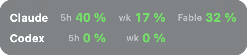

# burnrate 🔥

**How fast are you burning through your Claude Code and Codex limits?** burnrate puts the answer in a tiny always-on-top widget in the corner of your Mac's screen, so you never have to type `/usage` again or get surprised by a limit halfway through a task.

[](LICENSE)

[](#built-with-claude)


<p>
  
</p>
<p>
  
  &nbsp;
  
</p>

<sub>Mini · Compact · Details. Real numbers from a real Monday morning.</sub>

## Features

- **Three sizes.** *Mini* is just the percentages, one column per limit, *Compact* adds bars, reset times and pace, *Details* adds the token breakdown. Switch any time.
- **Your limits at a glance.** Session and weekly usage in %, plus any extra per-model limit your plan has (e.g. Fable), the same numbers `/usage` (Claude Code) and `/status` (Codex) show, with time until reset.
- **Pace & projection.** Average %/h since the window started and where you'll end up at reset (the lighter part of the bar). If you're on track to hit the limit early, it tells you when.
- **Burn rate.** Tokens per minute over the last 30 minutes, straight from your local session logs.
- **Details.** Tokens for the last 5 h, today and this week, split by model, plus a 5-hour activity chart.
- **Stays out of the way.** Floats above your windows on every desktop, remembers where you put it, and only shows the tools you actually have set up. Codex can be hidden entirely if you only care about Claude.
- **Speaks your language.** German on German systems, English everywhere else.

## Getting Started

### Requirements

- Logged in to **Claude Code** with a Claude subscription and/or to the **Codex CLI** with a ChatGPT account.
- **macOS** with the Swift compiler from the Xcode Command Line Tools (`xcode-select --install`). burnrate compiles itself on first start, which takes a few seconds.

### Install & run

```sh
git clone https://github.com/sven-haude/burnrate.git
```

…or download the ZIP from the green **Code** button. Then:

- **Start:** double-click `start.command` (or run `./start.command`).
- **Start automatically at login:** `macos/install-autostart.sh`. To remove it again: `macos/uninstall-autostart.sh`.

> If macOS refuses to open `start.command` from a downloaded ZIP, right-click it → **Open** once, or run `./start.command` in Terminal.

## Usage

- **Switch views:** the buttons at the bottom (*Mini ▴*, *Details ▾*, *Less ▴*), or right-click → *Mini / Compact / Details*. In Mini, right-click to get back.
- **Move it:** drag it anywhere. The position is remembered.
- **Right-click** also gives you *Show Codex* (hide or show the Codex section, including its API calls), *Refresh now*, *Move to top left* and *Quit*.
- **Hover** over a value in Mini view to see the full name and reset time.

## Configuration

Everything lives in [`config.env`](config.env): refresh interval, burn-rate window, endpoints and file locations. Run the start script again after changing it.

## How it works

- burnrate reuses the login token that Claude Code and Codex already keep on your Mac (the macOS Keychain and `~/.codex/auth.json`) and calls the same usage endpoints the CLIs call. The token is only ever sent to those endpoints. burnrate never refreshes tokens; if one has expired, open Claude Code or Codex once.
- Token counts come from the local session logs (`~/.claude/projects`, `~/.codex/sessions`). They're only read, never sent anywhere. That's also why they cover Claude Code and the Codex CLI, but not claude.ai or ChatGPT in the browser.
- "Tok" means input + output + cache-write tokens. Cache reads are shown separately because they're cheap and would drown out everything else.

## Good to know

- **Unofficial.** burnrate is not affiliated with Anthropic or OpenAI. The usage endpoints are undocumented and may change at any time. If they do, the widget shows a warning instead of numbers.
- **Don't poll too often.** The endpoints rate-limit (HTTP 429), so keep the refresh interval at a minute or more.
- **Projections are straight lines.** The weekly projection overshoots early in the week and settles down as the week goes on.
- **macOS only.** A Windows or Linux port would be welcome.

## Contributing

It's deliberately small: the whole widget is one Swift file ([`macos/Burnrate.swift`](macos/Burnrate.swift)). Fork it, make it yours, and send a pull request if you build something others would like too.

The repo includes a [`CLAUDE.md`](CLAUDE.md), so if you work on it with Claude Code, Claude already knows how the project is put together.

## Built with Claude

burnrate was built in pair-programming sessions with [Claude Code](https://claude.com/claude-code): Sven brought the idea and the direction and tried every version on a real desktop, Claude wrote most of the code and docs. Commits made this way carry a `Co-Authored-By: Claude` trailer, so GitHub credits Claude as co-author.

## Contributors

- **Sven Haude** ([@sven-haude](https://github.com/sven-haude)): idea, direction, testing
- **Claude** (Anthropic): co-author of the code and docs

## License

[MIT](LICENSE) © 2026 Sven Haude
